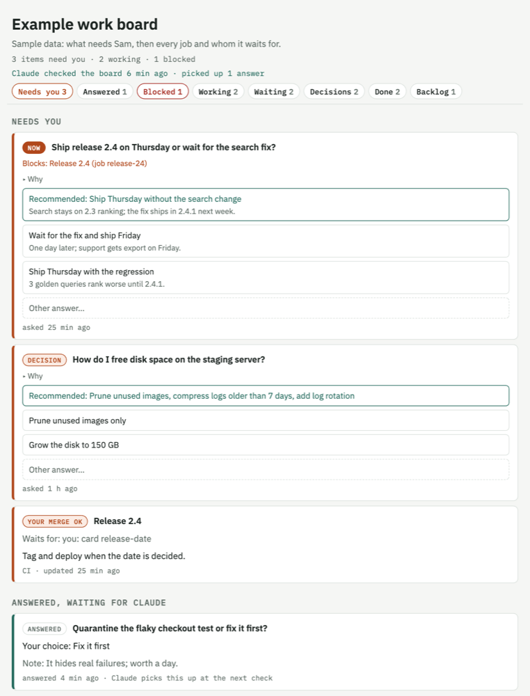

# work-board

A Claude Code skill for a personal **work board**: one live page where you
answer Claude's decision questions with one click, and see every running
job and whom it waits for.

The board is a claude.ai artifact with a small database. Claude writes
decision cards and job records; you click an option (or type your own
answer); Claude picks the answer up and acts on it.

<picture>
  <source media="(prefers-color-scheme: dark)" srcset="docs/board-dark.png">
  
</picture>

*Sample data. Top of the page: decisions first, then jobs by whom they wait for.*

## What the page shows

- **Needs you** — decision cards, urgent first, recommended option marked.
- **Answered, waiting for Claude** — your clicks Claude has not acted on yet.
- **Blocked / Working / Waiting for others** — every job and who it waits for.
- **Recent decisions, Recently done, Backlog** — collapsed by default.
- A heartbeat line ("Claude checked the board 5 min ago") and a stale mark on
  jobs not updated for 12 hours.

## Install

Copy this folder to `~/.claude/skills/work-board/` (or a project's
`.claude/skills/`). Then ask Claude: "set up a work board for this project".
Claude publishes `assets/board.html` as a private artifact and records its
URL in your project instructions.

For answers to be picked up while you are away, schedule a recurring prompt
(for example every 15 minutes) that says "board pickup".

## FAQ

**We already use Jira (or Linear, GitHub Projects, Asana). Is this a second
tracker?**
No. Your tracker stays the source of truth for the team's tasks. The board
is the channel between you and Claude: the questions Claude needs you to
answer, and the status of the work Claude itself is running. A board job
that belongs to a ticket carries the ticket link and key; Claude keeps
updating the ticket in your tracker as usual. Decisions the team should see
also go to the tracker or team channel. If you want no second place at all,
use only the decision cards.

**Who can see the board?**
It is a private claude.ai artifact: only you, until you share it from the
page's Share menu. Everyone you share it with can read it; only you (the
owner or editors) and Claude can change it. Never put secrets on it.

**How does Claude see my answers when I am away?**
A scheduled prompt ("board pickup", for example every 15 minutes) makes
Claude read new answers, act on them and write a heartbeat. The page shows
when Claude last checked.

**Can I answer in chat instead?**
Yes. Reply with the option number or your own words; Claude records the
answer on the card so the board stays complete.

## Files

- `SKILL.md` — the workflow Claude follows.
- `references/schema.md` — data fields and stages.
- `assets/board.html` — the page template.
- `evals/` — test cases (`claude plugin eval .` runs them).
- `docs/` — README pictures.
